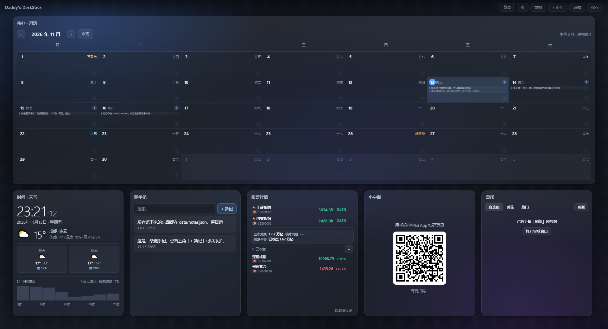

# DeskStick

[简体中文](README.md) | **English**

A local information board that sits **above desktop icons and below normal windows** on Windows. Always visible, glance anytime.

Plain HTML/CSS/JS frontend + a zero-dependency Node service + a C# WebView2 host. The target machine needs neither Node nor .NET — only the WebView2 runtime that ships with Windows.

---



> First run. Xiaoyuzhou needs a QR login and Xueqiu needs its own window logged in before they show content.

## What's inside

| Card | Description |
|---|---|
| **Calendar todos** | Todos laid out on a month grid. 1–5 weeks visible, font size auto-scales with row count |
| **Clock & weather** | Clock, date, live weather. Dual source (wttr.in / Open-Meteo) behind a backend proxy; keeps last known data when offline |
| **Quick notes** | Write, edit, full-text search. Paste or drag in images (auto-compressed to 1600px) |
| **Quick access** | Browse a folder; click a file to open it in Explorer; right-click to change folder |
| **Progress** | Custom goal and current value, ring visualization |
| **Stock quotes** | Watchlist quotes, Chinese-character search, 60s refresh, red up / green down |
| **Xiaoyuzhou** | QR login, subscriptions, listening history, discovery feed, built-in player with resume |
| **Xueqiu** | Separate WebView2 window for login; watchlist quotes plus following / trending timelines |

## Quick start

**Run from source**

```bash
node server.js
```

Then open `http://127.0.0.1:7788/`.

**Double-click launcher**

`Start DeskStick.bat` starts the service in the background and opens a chromeless Edge app-mode window. Run `停止服务.bat` to stop the service.

**Build a standalone EXE**

```bash
python dist/build.py
```

Produces `dist/DeskStick.exe` (~35 MB, self-extracting, bundles the Node runtime). The target machine only needs WebView2.

## Using it

- **Add a card** — `+ 组件` (top right)
- **Move / resize** — click `编辑` to enter edit mode, drag the title bar to move, drag the top-left or bottom-right corner to resize
- **Opacity** — drag the slider at the card's bottom in edit mode, or adjust all cards from the tray menu
- **Save** — `Ctrl+S` flushes immediately (everything also autosaves)
- **Remove** — hover a card, click `✕` at the right of the title bar

While dragging, positions snap to an 8px grid. On release, cards auto-align: same-row cards within 40px of each other get a unified height, and gaps are redistributed to a standard 20px.

## Layout

```
server.js              Local service (static files + JSON persistence + weather/Xiaoyuzhou proxies)
xz.js                  Xiaoyuzhou HTTP wrapper
data/                  All state, plain JSON — copy the folder to back up
public/                Frontend
  js/main.js           Layout engine: drag, resize, snapping, alignment, DPI adaptation
  js/registry.js       Card registry
  js/widgets/          The seven cards
  css/app.css          All styles; visual tokens live in :root
desktop/               C# WebView2 host
  DeskHost.cs          Main window, tray menu, multi-monitor, Xueqiu bridge
  XueqiuWindow.cs      Dedicated Xueqiu window
dist/                  Build tooling
  build.py             Assemble + zip + compile launcher + validate
  make_clean_data.py   Generate sample data
  clean-data/          Sample data source
```

## Configuration

All state lives in JSON under `data/`. Restart the service after editing:

| File | Contents |
|---|---|
| `layout.json` | Card position, size, opacity, z-order |
| `settings.json` | Fonts, colors, calendar rows/weeks, UI scale |
| `todos.json` | Todos |
| `notes.json` | Note bodies; images in `notes-img/` |
| `stocks.json` | Watchlist and refresh interval |
| `fsroots.json` | Quick-access folder list |
| `xiaoyuzhou.json` | Xiaoyuzhou credentials (**contains tokens — do not share**) |

UI scale defaults to `auto` (screen width ÷ 1920, clamped to 0.6–2.4). Override to 100% / 125% / 150% / 200% from the settings panel.

## Architecture

```
┌─────────────────────────────────────────────────────────────┐
│                      桌面（Windows）                          │
│                                                             │
│   ┌───────────────────────────────────────────────────┐     │
│   │  DeskHost.exe  ── C# WebView2 宿主                 │     │
│   │                                                    │     │
│   │  托盘菜单 · 显示器切换 · WS_EX_TOOLWINDOW + WorkerW │     │
│   │                                                    │     │
│   │  ┌──────────────────────┐  ┌──────────────────────┐│     │
│   │  │ 主窗口 WebView2       │  │ 雪球窗口 WebView2     ││     │
│   │  │ 用户目录 wv2data/     │  │ wv2data_xueqiu/      ││     │
│   │  └──────────┬───────────┘  └──────────┬───────────┘│     │
│   └─────────────┼─────────────────────────┼────────────┘     │
└─────────────────┼─────────────────────────┼──────────────────┘
                  │  http://127.0.0.1:7788  │
┌─────────────────▼─────────────────────────▼──────────────────┐
│              Node 本地服务  ──  server.js                     │
│                                                              │
│   静态托管   ·   JSON 读写   ·   /api/weather   ·  /api/xyz/* │
└──────┬────────────────────────────────────────────┬──────────┘
       │                                            │
┌──────▼──────────┐                        ┌────────▼─────────┐
│  data/*.json    │                        │  外部接口         │
│                 │                        │                  │
│  layout         │                        │  wttr.in         │
│  settings       │                        │  Open-Meteo      │
│  todos  notes   │                        │  xiaoyuzhou.fm   │
│  stocks fsroots │                        │  stock.xueqiu    │
│  xiaoyuzhou     │                        └──────────────────┘
└─────────────────┘
```

**前端（`public/`，跑在主窗口 WebView2 里）**

```
┌────────────────────────────────────────────────┐
│  main.js  布局引擎                              │
│  拖动 · 双角缩放 · 8px 网格吸附 · 松手自动对齐    │
│  分辨率自适应（zoom = 屏宽 ÷ 1920）              │
├────────────────────────────────────────────────┤
│  registry.js  卡片注册表                        │
├────────────────────────────────────────────────┤
│  widgets/  七张卡片                             │
│                                                │
│  todos    clock    notes    files              │
│  stocks   xyz      xueqiu                      │
├────────────────────────────────────────────────┤
│  app.css  全部样式（视觉参数集中在 :root）        │
└────────────────────────────────────────────────┘
```

## Implementation notes

**Desktop-layer positioning** — the WebView2 host sets `WS_EX_TOOLWINDOW` and reparents the window under `WorkerW`, which is what puts it above icons but below normal windows.

**Multi-monitor** — the tray menu's monitor submenu switches the target screen; the device name persists in `desktop/host.json`. If that screen disappears, the app falls back to the primary.

**Why Xueqiu needs its own window** — its core APIs require a logged-in session, and frequent cookie-less requests trip the WAF (`IP Blacklisted`). A separate WebView2 instance with its own user-data folder behaves like a normal browser session, which the APIs accept. Async results must come back via `chrome.webview.postMessage`; `ExecuteScriptAsync` does not await a Promise and returns `"{}"`.

**Xiaoyuzhou token refresh** — on an expired access token the service calls `/app_auth_tokens.refresh` and retries. If the refresh token is also dead, the UI falls back to QR login.

**Why weather goes through the backend** — neither wttr.in nor Open-Meteo sends CORS headers, so browser-side `fetch` is blocked. Everything goes through `/api/weather`.

## Known limitations

- Xueqiu's "following" and "trending" tabs are scraped from the web DOM (official endpoints return 403), so a site redesign can break them
- Xueqiu's website has no "recommended" tab — only "trending"
- Xiaoyuzhou's full leaderboard detail endpoint returns 404; the editor-picks history feed is used instead
- Market data is for demonstration only, not investment advice

## Backup

Copy the whole `data/` folder. To restore, copy it back and restart the service.

## License

Personal use only.
