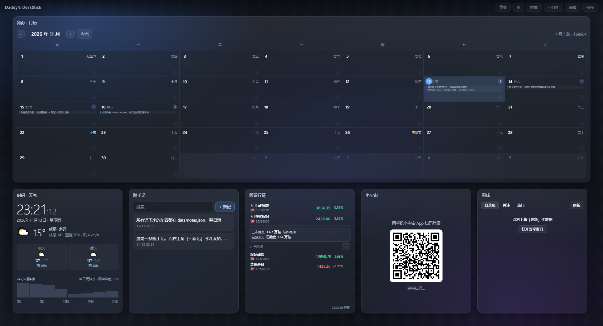

# 桌贴 · Daddy's DeskStick

[English](README.en.md) | **简体中文**

贴在 Windows 桌面图标之上、普通窗口之下的一层信息看板。常驻可见，随时瞄一眼。

纯 HTML/CSS/JS 前端 + 零依赖 Node 服务 + C# WebView2 宿主。目标机器不需要装 Node、不需要 .NET，只要系统自带 WebView2。

---



> 首次运行的样子。小宇宙要扫码登录、雪球要开窗口登录之后才有内容。

## 功能

| 卡片 | 说明 |
|---|---|
| **待办月历** | 按日期格子排布，月视图 1~5 周可调，格子字号随行数自动缩放 |
| **时间 · 天气** | 时钟 + 日期 + 实时天气，双源（wttr.in / Open-Meteo）经后端代理，断网保留上次数据 |
| **随手记** | 记录 / 编辑 / 全文搜索，支持粘贴和拖入图片（自动压缩到 1600px） |
| **快速访问** | 浏览指定目录，单击用资源管理器打开，右键可换目录 |
| **进度** | 自定义目标与当前值，环形进度 |
| **股票行情** | 自选股实时报价，汉字检索，60 秒刷新，涨红跌绿 |
| **小宇宙** | 二维码登录，订阅 / 收听历史 / 发现 / 编辑精选，内置播放器与续播进度 |
| **雪球** | 独立 WebView2 窗口登录，自选股行情 + 关注 / 热门动态 |

## 快速开始

**方式一：直接跑源码**

```bash
node server.js
```

然后浏览器打开 `http://127.0.0.1:7788/`。

**方式二：双击启动**

`Start DeskStick.bat` —— 后台拉起服务，用 Edge 应用模式开一个无地址栏窗口。停服务跑 `停止服务.bat`。

**方式三：打包成 EXE**

```bash
python dist/build.py
```

产出 `dist/DeskStick.exe`（约 35 MB，自解压，内含 Node 运行时）。目标机只需要 WebView2。

## 操作

- **添加卡片** —— 右上角 `+ 组件`
- **移动 / 缩放** —— 点 `编辑` 进入编辑模式，拖标题栏移动，拖左上角或右下角改尺寸
- **透明度** —— 编辑模式下拖卡片底部滑杆，或托盘菜单统一调
- **保存** —— `Ctrl+S` 立即落盘（平时也会自动保存）
- **移除** —— 鼠标移到卡片上，点标题栏右侧 `✕`

拖动时按 8px 网格吸附，松手后自动对齐：同行卡片高度差 ≤40px 会统一，间距自动均分到 20px。

## 目录结构

```
server.js              本地服务（静态托管 + JSON 读写 + 天气/小宇宙代理）
xz.js                  小宇宙 HTTP 封装
data/                  全部数据（JSON，整目录复制即备份）
public/                前端
  js/main.js           布局引擎：拖动、缩放、吸附、对齐、分辨率自适应
  js/registry.js       卡片注册表
  js/widgets/          七张卡片的实现
  css/app.css          全部样式，视觉参数集中在 :root
desktop/               C# WebView2 宿主
  DeskHost.cs          主窗口、托盘菜单、多显示器、雪球桥接
  XueqiuWindow.cs      独立的雪球窗口
dist/                  打包脚本
  build.py             组装 + 压缩 + 编译 launcher + 校验
  make_clean_data.py   生成示例数据
  clean-data/          示例数据源
```

## 配置

所有状态都在 `data/` 下的 JSON 里，改完重启服务生效：

| 文件 | 内容 |
|---|---|
| `layout.json` | 卡片位置、尺寸、透明度、层级 |
| `settings.json` | 字体、配色、月历行数与周数、界面缩放 |
| `todos.json` | 待办 |
| `notes.json` | 随手记正文；图片在 `notes-img/` |
| `stocks.json` | 自选股列表与刷新间隔 |
| `fsroots.json` | 快速访问的目录列表 |
| `xiaoyuzhou.json` | 小宇宙登录凭证（**含 token，勿外传**） |

界面缩放默认 `auto`（屏宽 ÷ 1920，夹在 0.6~2.4），可在设置面板手动覆盖为 100% / 125% / 150% / 200%。

## 架构

```
┌─────────────────────────────────────────────────────────────┐
│                      桌面（Windows）                          │
│                                                             │
│   ┌───────────────────────────────────────────────────┐     │
│   │  DeskHost.exe  ── C# WebView2 宿主                 │     │
│   │                                                    │     │
│   │  托盘菜单 · 显示器切换 · WS_EX_TOOLWINDOW + WorkerW │     │
│   │                                                    │     │
│   │  ┌──────────────────────┐  ┌──────────────────────┐│     │
│   │  │ 主窗口 WebView2       │  │ 雪球窗口 WebView2     ││     │
│   │  │ 用户目录 wv2data/     │  │ wv2data_xueqiu/      ││     │
│   │  └──────────┬───────────┘  └──────────┬───────────┘│     │
│   └─────────────┼─────────────────────────┼────────────┘     │
└─────────────────┼─────────────────────────┼──────────────────┘
                  │  http://127.0.0.1:7788  │
┌─────────────────▼─────────────────────────▼──────────────────┐
│              Node 本地服务  ──  server.js                     │
│                                                              │
│   静态托管   ·   JSON 读写   ·   /api/weather   ·  /api/xyz/* │
└──────┬────────────────────────────────────────────┬──────────┘
       │                                            │
┌──────▼──────────┐                        ┌────────▼─────────┐
│  data/*.json    │                        │  外部接口         │
│                 │                        │                  │
│  layout         │                        │  wttr.in         │
│  settings       │                        │  Open-Meteo      │
│  todos  notes   │                        │  xiaoyuzhou.fm   │
│  stocks fsroots │                        │  stock.xueqiu    │
│  xiaoyuzhou     │                        └──────────────────┘
└─────────────────┘
```

**前端（`public/`，跑在主窗口 WebView2 里）**

```
┌────────────────────────────────────────────────┐
│  main.js  布局引擎                              │
│  拖动 · 双角缩放 · 8px 网格吸附 · 松手自动对齐    │
│  分辨率自适应（zoom = 屏宽 ÷ 1920）              │
├────────────────────────────────────────────────┤
│  registry.js  卡片注册表                        │
├────────────────────────────────────────────────┤
│  widgets/  七张卡片                             │
│                                                │
│  todos    clock    notes    files              │
│  stocks   xyz      xueqiu                      │
├────────────────────────────────────────────────┤
│  app.css  全部样式（视觉参数集中在 :root）        │
└────────────────────────────────────────────────┘
```

## 技术要点

**桌面层定位** —— WebView2 宿主把窗口设为 `WS_EX_TOOLWINDOW` 并挂到 `WorkerW` 下，实现「在图标之上、普通窗口之下」。

**多显示器** —— 托盘菜单「显示器」可切换目标屏，设备名存 `desktop/host.json`；目标屏拔掉自动回退主屏。

**雪球为什么用独立窗口** —— 核心接口要求登录态，且高频无 Cookie 请求会触发 WAF（`IP Blacklisted`）。用独立用户目录的 WebView2 走正常浏览器会话，接口才通。异步结果通过 `chrome.webview.postMessage` 回传，不能用 `ExecuteScriptAsync` 等 Promise。

**小宇宙 token 刷新** —— access 过期时自动调 `/app_auth_tokens.refresh` 重试；refresh 也失效则回二维码登录页。

**天气为什么走后端** —— wttr.in 和 Open-Meteo 都不带 CORS 头，浏览器直连会被拦，必须经 `/api/weather` 代理。

## 已知限制

- 雪球的「关注」「热门」靠网页 DOM 抓取（官方接口 403），页面改版可能失效
- 雪球网页版没有「推荐」栏，只有「热门」
- 小宇宙的完整榜单详情接口 404，目前用编辑精选历史分页代替
- 证券行情数据仅演示用，不构成投资建议

## 数据备份

`data/` 整个目录复制走就是完整备份。恢复时覆盖回去，重启服务。

## 许可

仅供个人使用。
